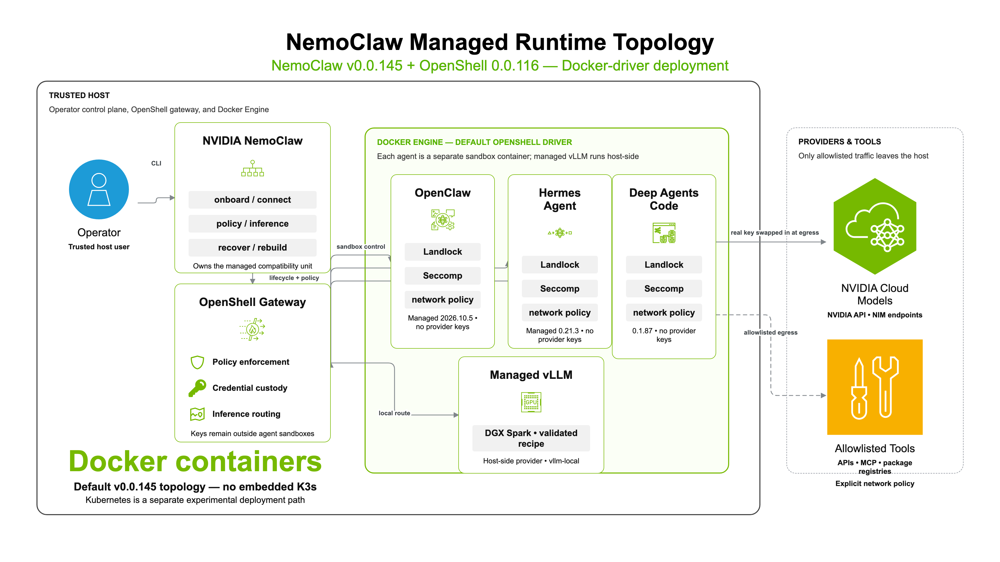

## What you will learn

- Which layer owns lifecycle management, runtime enforcement, and agent behavior, and why a managed compatibility unit differs from "latest of everything"
- The Docker-driver deployment: which containers exist, where each one runs, and which boundary enforces each control
- How one inference request travels from a sandbox to NVIDIA's hosted models, and where `inference.local` still applies
- The trusted-operator assumptions and the recovery boundary: rebuild, recover, and download

## Before you start

This lesson is reading only, so you can work through it while setup is still running. It builds on
[From Your Agent to an Agent Harness](/learn/agent-harness), which introduced the three
layers. Here you learn each one's responsibilities in the detail you need to operate them.

```stack-map
caption: "The three layers from the first lesson. This lesson is about what each one owns and how they fit together."
```

---

## 1. Who owns which decision

Start by asking **which layer owns the decision**:

| Responsibility | Primary owner | Examples |
|---|---|---|
| Install, onboard, select an agent, apply policy presets, change managed inference, rebuild, recover | **[NVIDIA NemoClaw](https://docs.nvidia.com/nemoclaw/latest/user-guide/openclaw/about/overview)** | `nemoclaw onboard`, `nemoclaw <name> status`, `nemoclaw <name> rebuild` |
| Create the isolation boundary, enforce filesystem/process/network policy, hold provider credentials, route inference | **[NVIDIA OpenShell](https://docs.nvidia.com/openshell/v0.0.116/about/overview)** | gateway, sandbox container, attached provider, `inference.local` |
| Run the agent loop: keep the conversation, offer the model its tools, and run the ones it asks for | **Agent harness** | OpenClaw, Hermes Agent, Deep Agents Code |

NemoClaw `v0.0.145` treats its OpenShell and agent versions as a tested compatibility unit. The course records newer standalone releases separately in **Upstream and Managed Compatibility Status (`docs/UPSTREAM_STATUS.md` in the course repository)** instead of mixing them into a running sandbox.

You met the three harnesses NemoClaw can install in [the first lesson](/learn/agent-harness), which compares them side by side. This distilled course uses **OpenClaw** for every hands-on lab; Hermes Agent and Deep Agents Code are covered in the full `claw-training-assets` course. OpenShell gives each harness the same kind of external enforcement boundary; it does not make their features identical.

### A useful analogy, and where it stops

A Linux analogy helps you remember the roles:

| Agent stack | Linux analogy | What the analogy explains |
|---|---|---|
| OpenShell | Kernel and security boundary | The workload cannot grant itself more filesystem, process, network, or credential access |
| Agent harness | User space / application environment | Different harnesses expose different interaction, memory, tool, and orchestration models |
| NemoClaw | Installer plus lifecycle operator | A supported set of components is installed and managed together |

The analogy is not literal: OpenShell is a sandbox runtime and gateway, not a general-purpose operating-system kernel; an agent harness is an application, not a Linux distribution. Use the analogy to locate responsibility, then use the actual product names when diagnosing a system.

## 2. Where it runs

The architecture has four places to reason about:

1. **Trusted operator and host** — controls NemoClaw, Docker, and the OpenShell gateway.
2. **OpenShell gateway** — owns policy distribution, credential custody, sandbox lifecycle, and inference routing.
3. **Sandbox container** — runs one selected agent harness with least-privilege filesystem, process, and network access.
4. **Providers and tools** — local managed vLLM, NVIDIA cloud models, package registries, APIs, or MCP servers reached only through approved routes.

A useful diagnosis names both the failing component and the boundary: “the OpenClaw process in sandbox `agent` was denied by its OpenShell network policy” is actionable; “NemoClaw is broken” is not.



The default v0.0.145 course path uses the **OpenShell Docker driver**, which creates agent sandboxes as **Docker containers**. The OpenShell gateway runs on the trusted host and controls those containers. Managed vLLM is another host-side container on supported NVIDIA GPU systems such as DGX Spark. Cloud inference and tools remain outside the host and are reached only through routes that OpenShell policy approves.

NemoClaw's default topology does **not** embed Kubernetes. Native Kubernetes/OpenShift is outside the NemoClaw support contract, and OpenShell has a separate, experimental Kubernetes deployment path that this course does not use. The current authority is the [NemoClaw platform support matrix](https://docs.nvidia.com/nemoclaw/latest/user-guide/openclaw/reference/platform-support).

## 3. Defense in depth: which boundary enforces what

| Boundary | Mechanism | Stops | Evidence surface |
|---|---|---|---|
| Container | Docker namespaces, cgroups, capabilities | Host/process isolation failures | `docker inspect`, `nemoclaw <name> status` |
| Filesystem | OpenShell `filesystem_policy` + Landlock | Reads/writes outside approved paths | `nemoclaw <name> policy get`, deny logs |
| Process | OpenShell process policy + Seccomp/runtime controls | Disallowed users, groups, syscalls, or privilege assumptions | sandbox command result, gateway logs |
| Network | Binary-scoped `network_policies` | Unapproved host, port, protocol, method, or path | policy view and OpenShell logs |
| Credentials and inference | Host-side credential custody + attached providers, or `inference.local` routing | Provider keys appearing in the agent filesystem or prompt | provider state, route state, sanitized logs |

These controls are valuable because they are outside the model's instruction-following loop. Prompt text can request access; it cannot grant access. Review the [OpenShell policy schema](https://docs.nvidia.com/openshell/v0.0.116/reference/policy-schema) and [security practices](https://docs.nvidia.com/openshell/v0.0.116/security/best-practices) before widening a boundary.

The [Sandbox Policies](/learn/sandbox-policies) lesson builds and runs the whole policy; for now, notice that one network entry is explicit and reviewable:

```yaml
network_policies:
  github-readonly:
    name: github-api-readonly
    endpoints:
      - host: api.github.com
        port: 443
        protocol: rest
        enforcement: enforce
        access: read-only
    binaries:
      - path: /usr/bin/curl
```

## 4. Trace an inference request


1. The harness sends an OpenAI-compatible request from inside its sandbox to the provider's own endpoint, `https://integrate.api.nvidia.com/v1`. In place of a key, the request carries a placeholder.
2. OpenShell checks the destination, the calling binary, and the request path against the provider attached to that sandbox, `nemoclaw-nvidia-prod-v1`.
3. OpenShell swaps the placeholder for the real key at the sandbox boundary.
4. The request goes on to NVIDIA's model API.
5. The response returns to the harness without exposing the provider key.

This path is the architectural payoff: the model can use inference without possessing the long-lived credential. See [NemoClaw inference routing](https://docs.nvidia.com/nemoclaw/latest/user-guide/openclaw/inference/about-inference-routing) and the [NemoClaw provider-switch workflow](https://docs.nvidia.com/nemoclaw/latest/user-guide/openclaw/inference/switch-inference-providers).

Earlier NemoClaw releases sent this request to `inference.local`, a shared OpenShell route. That route still exists in OpenShell: NemoClaw uses it for local NVIDIA NIM and for custom endpoints that have no attached provider, and a sandbox created by an earlier release keeps it until that sandbox is recreated. Where no shared route is configured, `inference.local` answers HTTP 503. The diagram also shows managed vLLM on a DGX Spark, the local alternative; this distilled course does not run that path. See [OpenShell inference routing](https://docs.nvidia.com/openshell/v0.0.116/sandboxes/inference-routing).

## 5. Operating it with NemoClaw

Use NemoClaw for operations that must keep the registry, gateway, sandbox, and agent configuration aligned:

```text
nemoclaw onboard
nemoclaw <name> status
nemoclaw <name> policy list
nemoclaw <name> connect
nemoclaw <name> download <sandbox-path> [host-dest]
nemoclaw <name> rebuild
nemoclaw <name> recover
```

A managed component mismatch is repaired by rebuild or re-onboard—not by upgrading OpenClaw with npm or updating OpenShell independently. For the same reason, change the provider or model through `nemoclaw inference set --sandbox <name> ...`. For NVIDIA Endpoints the command updates that sandbox's own attached provider and leaves the shared route alone. Earlier releases required a time-limited Shields window before this change. Shields has been removed from NemoClaw, so there is nothing to open first. Direct `openshell inference set` remains a lower-level operation for standalone OpenShell labs; using it on the shared managed gateway can desynchronize route, registry, and agent configuration.

Treat agent state and runtime state separately. An OpenClaw backup can preserve agent configuration and workspace data. `nemoclaw <name> rebuild` recreates the sandbox on the current managed image and carries the whole agent home across; `nemoclaw <name> recover` brings a crashed or stopped sandbox back to ready without replacing it. The snapshot commands of earlier releases are gone, so when you want a recovery point of your own, copy the files to the host with `nemoclaw <name> download`. Production recovery therefore asks both “is my agent data intact?” and “is the managed runtime still aligned?” The [NemoClaw commands reference](https://docs.nvidia.com/nemoclaw/latest/user-guide/openclaw/reference/commands) documents rebuild, recover, and download behavior.

## 6. Five questions for every lab

Every substantive lab should answer five questions:

1. **Choose** — Which harness and execution target fit the workload?
2. **Constrain** — Which files, processes, endpoints, tools, and credentials are actually required?
3. **Route** — Should inference use an NVIDIA cloud model or a managed local vLLM endpoint?
4. **Observe** — Which command output, gateway log, policy view, or OCSF event proves the behavior?
5. **Recover** — Which rebuild, `recover` run, pairing repair, or host copy restores a known-good state?

This sequence is more useful than memorizing commands. It makes the architecture visible in every exercise and gives you a repeatable customer-demo narrative: **capability with evidence, inside a boundary, with a recovery path**.

## 7. Trusted operator model

NemoClaw is designed around one trusted operator controlling a local or dedicated host. That operator can manage Docker and the OpenShell gateway; Docker access is effectively host-root authority. This is not a multi-tenant boundary between mutually hostile administrators.

The operator's responsibilities include:

- review skills, plugins, images, policy presets, and custom YAML before use;
- keep credentials in the gateway or approved host secret path, never lesson or terminal output;
- use explicit device identity for pairing recovery rather than `--latest`;
- copy files you cannot lose to the host with `nemoclaw <name> download` before risky changes, and rebuild managed components together.

The agent is untrusted **inside** the boundary; the operator and host are trusted **outside** it. That distinction is the foundation for every security claim in the course.

---

## Checkpoint

Explain the stack without using product slogans:

1. You need to change the model route for a NemoClaw-managed sandbox. Which layer owns the change?
   - **Expected:** NemoClaw, through `nemoclaw inference set`. It updates the sandbox's attached provider and the agent's configuration together; do not run `openshell inference set` on the managed gateway.
2. You want a coding terminal UI (TUI) with subagents instead of an always-on messaging assistant. What changes—and what stays the same?
   - **Expected:** select Deep Agents Code rather than OpenClaw; the OpenShell boundary and NemoClaw lifecycle remain.
3. Why not upgrade one managed component to its standalone latest release?
   - **Expected:** it breaks the tested compatibility unit and can desynchronize image, CLI, gateway, and registry state.
4. A sandbox can read `/sandbox/work` but not `/etc/shadow`. Which controls explain that result?
   - **Expected:** the container boundary plus OpenShell filesystem policy/Landlock.
5. The agent reaches `api.github.com` with curl but another binary is denied. Why?
   - **Expected:** network rules bind approved endpoints to approved binaries.
6. Inference succeeds, but printing `NVIDIA_INFERENCE_API_KEY` inside the sandbox shows only a placeholder. Where is the key?
   - **Expected:** on the trusted host, in OpenShell provider state; OpenShell swaps it in at the sandbox boundary for requests to the provider's endpoint.
7. Someone proposes Kubernetes for this deployment. What should you say?
   - **Expected:** the default NemoClaw path uses Docker sandbox containers; Kubernetes is a separate experimental OpenShell path and not this course runtime.

---

## What you have

- The owner of each decision: lifecycle, enforcement, and agent behavior, each assigned to the correct layer
- The Docker-driver topology: sandbox containers controlled by a gateway on the trusted host, with each security control mapped to an enforcement and evidence surface
- The path of a hosted NVIDIA inference request, which never places the provider key in the sandbox, and where `inference.local` still applies
- The choose → constrain → route → observe → recover workflow, and the trusted-operator model behind rebuild, recover, and pairing practices

## Next

If you started reading while setup was still running, go back to [Set Up Your Environment](/learn/setup) and run its check once the setup cell prints `Setup complete.`

Then continue to **[What Is OpenShell?](/learn/what-is-openshell)** to start working with the sandbox runtime.

---
**Sources:** [NemoClaw overview](https://docs.nvidia.com/nemoclaw/latest/user-guide/openclaw/about/overview) · [NemoClaw platform support](https://docs.nvidia.com/nemoclaw/latest/user-guide/openclaw/reference/platform-support) · [OpenShell overview](https://docs.nvidia.com/openshell/v0.0.116/about/overview) · [OpenShell policy schema](https://docs.nvidia.com/openshell/v0.0.116/reference/policy-schema) · [NemoClaw inference routing](https://docs.nvidia.com/nemoclaw/latest/user-guide/openclaw/inference/about-inference-routing) · [OpenShell inference routing](https://docs.nvidia.com/openshell/v0.0.116/sandboxes/inference-routing) · [OpenClaw](https://docs.openclaw.ai/start/openclaw) · [Deep Agents Code](https://docs.langchain.com/oss/python/deepagents/code/overview)
