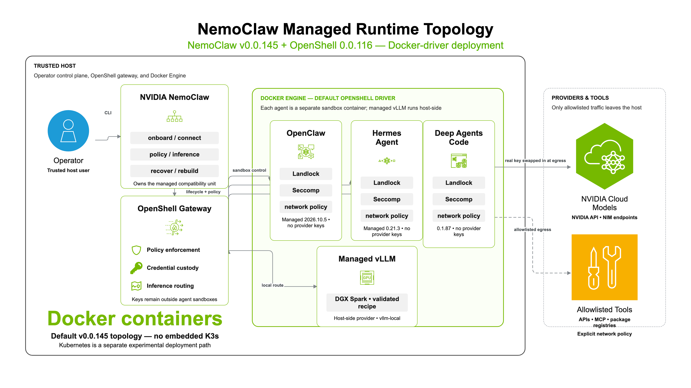

## Learning Objectives

By the end of this lesson, you will be able to:

- Describe the Docker-driver deployment: which containers exist and where each one runs
- Map filesystem, process, network, credential, and inference controls to their enforcement points
- Trace one inference request from a sandbox to NVIDIA's hosted models, and say where `inference.local` still applies
- Explain the trusted-operator assumptions and the recovery boundary: rebuild, recover, and download

## Before you start

This lesson is reading only; nothing needs to be installed yet.


---

## 1. Read the System as Trust Boundaries

The architecture has four places to reason about:

1. **Trusted operator and host** — controls NemoClaw, Docker, and the OpenShell gateway.
2. **OpenShell gateway** — owns policy distribution, credential custody, sandbox lifecycle, and inference routing.
3. **Sandbox container** — runs one selected agent harness with least-privilege filesystem, process, and network access.
4. **Providers and tools** — local managed vLLM, NVIDIA cloud models, package registries, APIs, or MCP servers reached only through approved routes.

A useful diagnosis names both the failing component and the boundary: “the OpenClaw process in sandbox `agent` was denied by its OpenShell network policy” is actionable; “NemoClaw is broken” is not.

## 2. Current Deployment Topology



The default v0.0.145 course path creates agent sandboxes as **Docker containers**. The OpenShell gateway runs on the trusted host and controls those containers. Managed vLLM is another host-side container on supported NVIDIA GPU systems such as DGX Spark. Cloud inference and tools remain outside the host and are reached only through routes that OpenShell policy approves.

NemoClaw's default topology does **not** embed Kubernetes. Native Kubernetes/OpenShift is outside the NemoClaw support contract, and OpenShell has a separate, experimental Kubernetes deployment path that this course does not use. The current authority is the [NemoClaw platform support matrix](https://docs.nvidia.com/nemoclaw/latest/user-guide/openclaw/reference/platform-support).

Diagram sources are kept beside the export: [HTML](/assets/diagrams/nemoclaw-runtime-topology.html) · [JSON specification](/assets/diagrams/nemoclaw-runtime-topology.json).

## 3. Defense in Depth: Which Boundary Enforces What?

| Boundary | Mechanism | Stops | Evidence surface |
|---|---|---|---|
| Container | Docker namespaces, cgroups, capabilities | Host/process isolation failures | `docker inspect`, `nemoclaw <name> status` |
| Filesystem | OpenShell `filesystem_policy` + Landlock | Reads/writes outside approved paths | `nemoclaw <name> policy get`, deny logs |
| Process | OpenShell process policy + Seccomp/runtime controls | Disallowed users, groups, syscalls, or privilege assumptions | sandbox command result, gateway logs |
| Network | Binary-scoped `network_policies` | Unapproved host, port, protocol, method, or path | policy view and OpenShell logs |
| Credentials and inference | Host-side credential custody + attached providers, or `inference.local` routing | Provider keys appearing in the agent filesystem or prompt | provider state, route state, sanitized logs |

These controls are valuable because they are outside the model's instruction-following loop. Prompt text can request access; it cannot grant access. Review the [OpenShell policy schema](https://docs.nvidia.com/openshell/v0.0.116/reference/policy-schema) and [security practices](https://docs.nvidia.com/openshell/v0.0.116/security/best-practices) before widening a boundary.

### A Valid Policy Shape (Read-Only Preview)

The [Sandbox Policies](/learn/sandbox-policies) lesson builds and executes this structure. For now, notice that each domain is explicit and reviewable:

```yaml
version: 1

filesystem_policy:
  include_workdir: false
  read_only: [/usr, /lib, /app, /sandbox]
  read_write: [/tmp, /dev/null, /sandbox/work]

landlock:
  compatibility: best_effort

process:
  run_as_user: sandbox
  run_as_group: sandbox

network_policies:
  github-readonly:
    name: github-api-readonly
    endpoints:
      - host: api.github.com
        port: 443
        protocol: rest
        enforcement: enforce
        access: read-only
    binaries:
      - path: /usr/bin/curl
```

A NemoClaw onboarding **tier** (`restricted`, `balanced`, `open`, or `personal`) selects service presets; `balanced` is the default. The `personal` tier lets every binary in the sandbox open connections on ports 80 and 443, so NemoClaw's documentation says not to use it with untrusted prompts or data. A tier does not replace the underlying OpenShell policy schema. Use `nemoclaw <name> policy add ... --dry-run` to review a managed preset; use raw OpenShell policy replacement only in the explicitly standalone Sandbox Policies lab.

## 4. Trace an Inference Request


1. The harness sends an OpenAI-compatible request from inside its sandbox to the provider's own endpoint, `https://integrate.api.nvidia.com/v1`. In place of a key, the request carries a placeholder.
2. OpenShell checks the destination, the calling binary, and the request path against the provider attached to that sandbox, `nemoclaw-nvidia-prod-v1`.
3. OpenShell swaps the placeholder for the real key at the sandbox boundary.
4. The request goes on to NVIDIA's model API.
5. The response returns to the harness without exposing the provider key.

This path is the architectural payoff: the model can use inference without possessing the long-lived credential. See [NemoClaw inference routing](https://docs.nvidia.com/nemoclaw/latest/user-guide/openclaw/inference/about-inference-routing) and the [NemoClaw provider-switch workflow](https://docs.nvidia.com/nemoclaw/latest/user-guide/openclaw/inference/switch-inference-providers). Diagram sources: [HTML](/assets/diagrams/credential-safe-inference-path.html) · [JSON specification](/assets/diagrams/credential-safe-inference-path.json).

Earlier NemoClaw releases sent this request to `inference.local`, a shared OpenShell route. That route still exists in OpenShell: NemoClaw uses it for local NVIDIA NIM and for custom endpoints that have no attached provider, and a sandbox created by an earlier release keeps it until that sandbox is recreated. Where no shared route is configured, `inference.local` answers HTTP 503. The diagram also shows managed vLLM on a DGX Spark, the local alternative; this distilled course does not run that path. See [OpenShell inference routing](https://docs.nvidia.com/openshell/v0.0.116/sandboxes/inference-routing).

On a NemoClaw-managed gateway, change the provider or model through `nemoclaw inference set --sandbox <name> ...`. For NVIDIA Endpoints the command updates that sandbox's own attached provider and leaves the shared route alone. Earlier releases required a time-limited Shields window before this change. Shields has been removed from NemoClaw, so there is nothing to open first. Direct `openshell inference set` remains a lower-level operation for standalone OpenShell labs; using it on the shared managed gateway can desynchronize route, registry, and agent configuration.

## 5. Agent State, Workspaces, and Recovery

The sandbox boundary is common, but state layout and interaction differ by harness:

- **OpenClaw** organizes assistants, sessions, workspaces, SOUL.md, skills, memory, dashboard, and messaging.
- **Hermes Agent** has its own dashboard, terminal UI, messaging channels, and OpenAI-compatible API, plus memory and skills that it writes and refines itself.
- **Deep Agents Code** uses the `dcode` terminal interface, plans, subagents, skills, and human approval gates.

Treat agent state and runtime state separately. An OpenClaw backup can preserve agent configuration and workspace data. `nemoclaw <name> rebuild` recreates the sandbox on the current managed image and carries the whole agent home across; `nemoclaw <name> recover` brings a crashed or stopped sandbox back to ready without replacing it. The snapshot commands of earlier releases are gone, so when you want a recovery point of your own, copy the files to the host with `nemoclaw <name> download`. Production recovery therefore asks both “is my agent data intact?” and “is the managed runtime still aligned?” The [NemoClaw commands reference](https://docs.nvidia.com/nemoclaw/latest/user-guide/openclaw/reference/commands) documents rebuild, recover, and download behavior.

## 6. Trusted Operator Model

NemoClaw is designed around one trusted operator controlling a local or dedicated host. That operator can manage Docker and the OpenShell gateway; Docker access is effectively host-root authority. This is not a multi-tenant boundary between mutually hostile administrators.

The operator's responsibilities include:

- review skills, plugins, images, policy presets, and custom YAML before use;
- keep credentials in the gateway or approved host secret path, never lesson or terminal output;
- use explicit device identity for pairing recovery rather than `--latest`;
- copy files you cannot lose to the host with `nemoclaw <name> download` before risky changes, and rebuild managed components together.

The agent is untrusted **inside** the boundary; the operator and host are trusted **outside** it. That distinction is the foundation for every security claim in the course.

---

## Checkpoint

Walk one failure through the architecture:

1. **A sandbox can read `/sandbox/work` but not `/etc/shadow`.** Which controls explain that result?
   - **Expected:** the container boundary plus OpenShell filesystem policy/Landlock.
2. **The agent reaches `api.github.com` with curl but another binary is denied.** Why?
   - **Expected:** network rules bind approved endpoints to approved binaries.
3. **Inference succeeds, but printing `NVIDIA_INFERENCE_API_KEY` inside the sandbox shows only a placeholder.** Where is the key?
   - **Expected:** on the trusted host, in OpenShell provider state; OpenShell swaps it in at the sandbox boundary for requests to the provider's endpoint.
4. **A component version differs after an in-sandbox npm install.** What is the recovery?
   - **Expected:** stop mixing components; rebuild or re-onboard the managed compatibility unit.
5. **Someone proposes Kubernetes for this deployment.** What should you say?
   - **Expected:** the default NemoClaw path uses Docker sandbox containers; Kubernetes is a separate experimental OpenShell path and not this course runtime.

---

## ✅ What You Accomplished

- Described the Docker-driver topology: sandbox containers controlled by a gateway on the trusted host
- Mapped each security control to an enforcement and evidence surface
- Traced hosted NVIDIA inference without placing the provider key in the sandbox, and learned where `inference.local` still applies
- Connected the trusted-operator model to rebuild, recover, and pairing practices

## Next Steps

If you have not done it yet, complete [Set Up Your Environment](/learn/setup). It installs the pinned stack, creates the `agent` sandbox, and proves first inference.

Then continue to **[What Is OpenShell?](/learn/what-is-openshell)** to start working with the sandbox runtime.

---
**Sources:** [NemoClaw overview](https://docs.nvidia.com/nemoclaw/latest/user-guide/openclaw/about/overview) · [NemoClaw platform support](https://docs.nvidia.com/nemoclaw/latest/user-guide/openclaw/reference/platform-support) · [OpenShell overview](https://docs.nvidia.com/openshell/v0.0.116/about/overview) · [OpenShell policy schema](https://docs.nvidia.com/openshell/v0.0.116/reference/policy-schema) · [NemoClaw inference routing](https://docs.nvidia.com/nemoclaw/latest/user-guide/openclaw/inference/about-inference-routing) · [OpenShell inference routing](https://docs.nvidia.com/openshell/v0.0.116/sandboxes/inference-routing)
