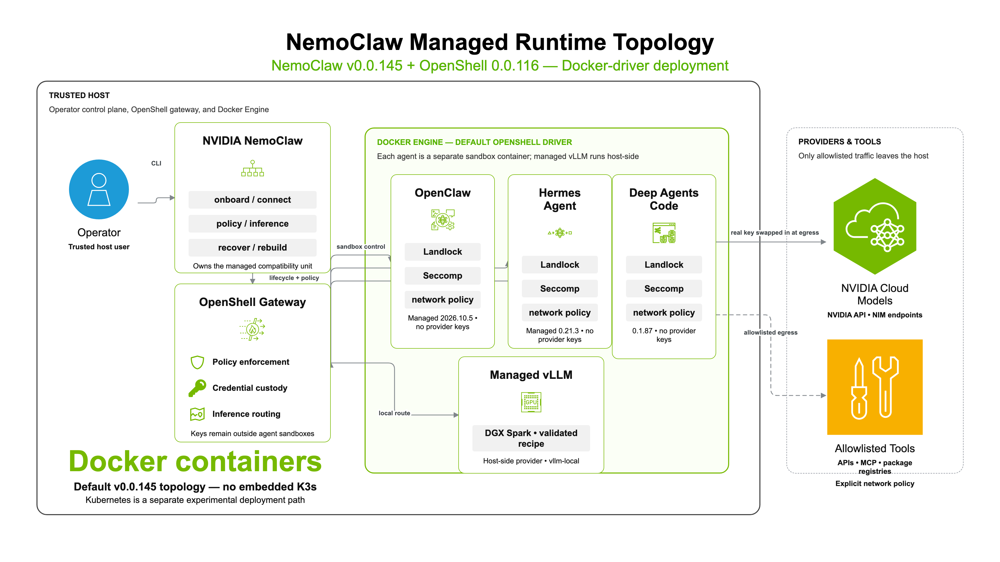
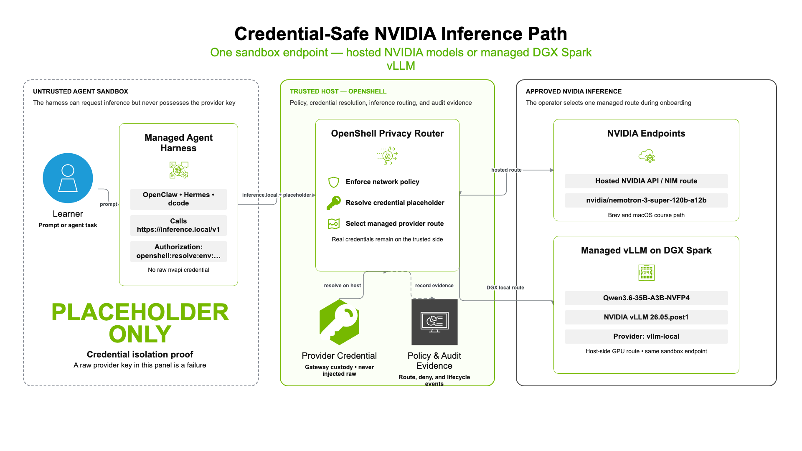

## Learning Objectives

By the end of this lesson, you will be able to:

- Describe the current Docker-driver deployment without relying on the retired embedded-K3s model
- Map filesystem, process, network, credential, and inference controls to their enforcement points
- Trace one inference request from a sandbox to local or cloud NVIDIA models
- Explain the trusted-operator assumptions and the snapshot/rebuild recovery boundary

## Before you start

This lesson is reading only; nothing needs to be installed yet.


---

## 1. Read the System as Trust Boundaries

The architecture has four places to reason about:

1. **Trusted operator and host** — controls NemoClaw, Docker, and the OpenShell gateway.
2. **OpenShell gateway** — owns policy distribution, credential custody, sandbox lifecycle, and inference routing.
3. **Sandbox container** — runs one selected agent harness with least-privilege filesystem, process, and network access.
4. **Providers and tools** — local managed vLLM, NVIDIA cloud models, package registries, APIs, or MCP servers reached only through approved routes.

A useful diagnosis names both the failing component and the boundary: “the OpenClaw process in sandbox `agent` was denied by its OpenShell network policy” is actionable; “NemoClaw is broken” is not.

## 2. Current Deployment Topology



The default v0.0.79 course path creates agent sandboxes as **Docker containers**. The OpenShell gateway runs on the trusted host and controls those containers. Managed vLLM is another host-side container on supported NVIDIA GPU systems such as DGX Spark. Cloud inference and tools remain outside the host and are reached through gateway-mediated, policy-approved routes.

The earlier course diagram showed an embedded K3s cluster. There is **no embedded K3s** in the default NemoClaw topology now. Native Kubernetes/OpenShift is outside the NemoClaw support contract, while OpenShell's separate Kubernetes deployment path remains experimental. The current authority is the [NemoClaw platform support matrix](https://docs.nvidia.com/nemoclaw/latest/user-guide/hermes/reference/platform-support).

Diagram sources are kept beside the export: [HTML](/assets/diagrams/nemoclaw-runtime-topology.html) · [JSON specification](/assets/diagrams/nemoclaw-runtime-topology.json).

## 3. Defense in Depth: Which Boundary Enforces What?

| Boundary | Mechanism | Stops | Evidence surface |
|---|---|---|---|
| Container | Docker namespaces, cgroups, capabilities | Host/process isolation failures | `docker inspect`, `nemoclaw <name> status` |
| Filesystem | OpenShell `filesystem_policy` + Landlock | Reads/writes outside approved paths | `nemoclaw <name> policy-get`, deny logs |
| Process | OpenShell process policy + Seccomp/runtime controls | Disallowed users, groups, syscalls, or privilege assumptions | sandbox command result, gateway logs |
| Network | Binary-scoped `network_policies` | Unapproved host, port, protocol, method, or path | policy view and OpenShell logs |
| Credentials and inference | Gateway custody + `inference.local` routing | Provider keys appearing in the agent filesystem or prompt | provider state, route state, sanitized logs |

These controls are valuable because they are outside the model's instruction-following loop. Prompt text can request access; it cannot grant access. Review the [OpenShell policy schema](https://docs.nvidia.com/openshell/reference/policy-schema) and [security practices](https://docs.nvidia.com/openshell/security/best-practices) before widening a boundary.

### A Valid Policy Shape (Read-Only Preview)

The [Sandbox Policies](/learn/sandbox-policies) lesson builds and executes this structure. For now, notice that each domain is explicit and reviewable:

```yaml
version: 1

filesystem_policy:
  include_workdir: false
  read_only: [/usr, /lib, /app, /sandbox]
  read_write: [/tmp, /dev/null, /sandbox/work]

landlock:
  compatibility: best_effort

process:
  run_as_user: sandbox
  run_as_group: sandbox

network_policies:
  github-readonly:
    name: github-api-readonly
    endpoints:
      - host: api.github.com
        port: 443
        protocol: rest
        enforcement: enforce
        access: read-only
    binaries:
      - path: /usr/bin/curl
```

A NemoClaw onboarding **tier** (`restricted`, `balanced`, or `open`) selects service presets. It does not replace the underlying OpenShell policy schema. Use `nemoclaw <name> policy-add ... --dry-run` to review a managed preset; use raw OpenShell policy replacement only in the explicitly standalone Sandbox Policies lab.

## 4. Trace an Inference Request



1. The harness sends an OpenAI-compatible request to `inference.local` from inside its sandbox.
2. The OpenShell gateway resolves the active provider and model route.
3. The gateway attaches the provider credential outside the sandbox boundary.
4. The request goes either to managed vLLM on the host or to an approved cloud endpoint such as NVIDIA's model API.
5. The response returns to the harness without exposing the provider key.

This path is the architectural payoff: the model can use inference without possessing the long-lived credential. See [OpenShell inference](https://docs.nvidia.com/openshell/inference/about) and the [NemoClaw provider-switch workflow](https://docs.nvidia.com/nemoclaw/latest/user-guide/openclaw/inference/switch-inference-providers). Diagram sources: [HTML](/assets/diagrams/credential-safe-inference-path.html) · [JSON specification](/assets/diagrams/credential-safe-inference-path.json).

On a NemoClaw-managed gateway, change the route through `nemoclaw inference set --sandbox <name> ...` inside the required bounded shields window. Direct `openshell inference set` remains a lower-level operation for standalone OpenShell labs; using it on the shared managed gateway can desynchronize route, registry, and agent configuration.

## 5. Agent State, Workspaces, and Recovery

The sandbox boundary is common, but state layout and interaction differ by harness:

- **OpenClaw** organizes assistants, sessions, workspaces, SOUL.md, skills, memory, dashboard, and messaging.
- **Hermes Agent** uses its own terminal workflow, memory, tools, and managed manifest.
- **Deep Agents Code** uses the `dcode` terminal interface, plans, subagents, skills, and human approval gates.

Treat agent state and runtime state separately. An OpenClaw backup can preserve agent configuration and workspace data; a NemoClaw snapshot/rebuild workflow preserves or reconstructs the managed sandbox boundary. Production recovery therefore asks both “is my agent data intact?” and “is the managed runtime still aligned?” The [NemoClaw commands reference](https://docs.nvidia.com/nemoclaw/latest/user-guide/openclaw/reference/commands) documents snapshot and rebuild behavior.

## 6. Trusted Operator Model

NemoClaw is designed around one trusted operator controlling a local or dedicated host. That operator can manage Docker and the OpenShell gateway; Docker access is effectively host-root authority. This is not a multi-tenant boundary between mutually hostile administrators.

The operator's responsibilities include:

- review skills, plugins, images, policy presets, and custom YAML before use;
- keep credentials in the gateway or approved host secret path, never lesson or terminal output;
- use explicit device identity for pairing recovery rather than `--latest`;
- use bounded shields windows with a reason, timeout, and restore check;
- snapshot before risky changes and rebuild managed components together.

The agent is untrusted **inside** the boundary; the operator and host are trusted **outside** it. That distinction is the foundation for every security claim in the course.

---

## Checkpoint

Walk one failure through the architecture:

1. **A sandbox can read `/sandbox/work` but not `/etc/shadow`.** Which controls explain that result?
   - **Expected:** the container boundary plus OpenShell filesystem policy/Landlock.
2. **The agent reaches `api.github.com` with curl but another binary is denied.** Why?
   - **Expected:** network rules bind approved endpoints to approved binaries.
3. **Inference succeeds but the agent cannot print `NVIDIA_API_KEY`.** Where is the key?
   - **Expected:** the trusted gateway holds and injects it for the routed request.
4. **A component version differs after an in-sandbox npm install.** What is the recovery?
   - **Expected:** stop mixing components; rebuild or re-onboard the managed compatibility unit.
5. **Someone proposes Kubernetes because the old diagram showed K3s.** What should you say?
   - **Expected:** the default NemoClaw path now uses Docker sandbox containers; Kubernetes is a separate experimental OpenShell path and not this course runtime.

---

## ✅ What You Accomplished

- Replaced the embedded-K3s mental model with the current Docker-driver topology
- Mapped each security control to an enforcement and evidence surface
- Traced local and cloud inference without placing provider keys in the sandbox
- Connected the trusted-operator model to snapshot, rebuild, and pairing practices

## Next Steps

If you have not run it yet, run `./setup.sh` from the repository root. It installs the pinned stack, creates the `agent` sandbox, and proves first inference.

Then continue to **[What Is OpenShell?](/learn/what-is-openshell)** to start working with the sandbox runtime.

---
**Sources:** [NemoClaw overview](https://docs.nvidia.com/nemoclaw/latest/about/overview.html) · [NemoClaw platform support](https://docs.nvidia.com/nemoclaw/latest/user-guide/hermes/reference/platform-support) · [OpenShell overview](https://docs.nvidia.com/openshell/about/overview) · [OpenShell policy schema](https://docs.nvidia.com/openshell/reference/policy-schema) · [OpenShell inference](https://docs.nvidia.com/openshell/inference/about)
