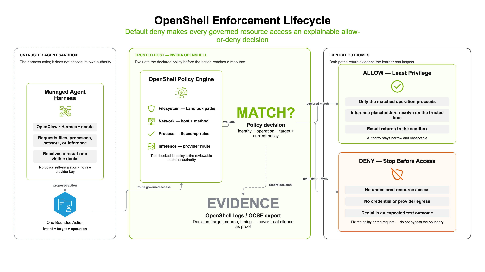

## Learning Objectives

By the end of this lesson, you will be able to:

- Explain what [OpenShell](https://docs.nvidia.com/openshell/about/overview) is and where it fits in the NemoClaw stack
- Use every core `openshell` CLI command
- Create, inspect, execute commands in, and delete [sandboxes](https://docs.nvidia.com/openshell/sandboxes/manage-sandboxes)
- Read sandbox [logs](https://docs.nvidia.com/openshell/observability/accessing-logs) and understand the log format
- View and apply sandbox [policies](https://docs.nvidia.com/openshell/reference/policy-schema)
- List and manage [inference providers](https://docs.nvidia.com/openshell/sandboxes/manage-providers)

## Before you start

Run `./setup.sh` from the course directory first; it creates the course sandbox. The shell on the right is a real shell on the course host. Every command block has a **Run in shell** button, and `$CLAW_SANDBOX` holds the name of the course sandbox.


---

## 1. What Is OpenShell?

OpenShell is the **sandbox runtime** that creates isolated environments for AI agents and
enforces security policies on everything they do. Think of it as a container runtime
built for AI agent safety.

Without a sandbox, an AI agent has the same access as the user who launched it — it can
read any file, reach any endpoint, and run any program. OpenShell removes that implicit
trust and replaces it with explicit, auditable policy controls. See the
[OpenShell Overview](https://docs.nvidia.com/openshell/about/overview) for the design rationale.

When you run an AI agent inside an OpenShell sandbox:

- The agent **cannot access files** outside its allowed paths
- The agent **cannot reach network endpoints** unless the policy explicitly allows them
- The agent **runs as a non-root user** with restricted system calls
- Every denied action is **logged** so you can audit what happened

### Where OpenShell Fits in the Stack

```
┌─────────────────────────────────────────────┐
│  You (the operator)                         │
│  Type commands, read output, watch dashboard │
├─────────────────────────────────────────────┤
│  NemoClaw CLI                               │  ← Deploys and manages agents
│  nemoclaw onboard / connect / logs          │
├─────────────────────────────────────────────┤
│  OpenShell                                  │  ← THIS MODULE
│  Creates sandboxes, enforces policies       │  ← Isolation + enforcement
│  openshell sandbox / policy / logs          │
├─────────────────────────────────────────────┤
│  OpenClaw (inside the sandbox)              │  ← The AI agent
│  Personality, skills, memory, channels      │  ← Talks to models, uses tools
└─────────────────────────────────────────────┘
```

OpenShell is the **middle layer** — it doesn't know what the agent does, only what the
agent is **allowed** to do. The policies you write in this module define that boundary.
For how the layers communicate, see the
[Architecture documentation](https://docs.nvidia.com/openshell/about/architecture).

### Follow One Action Through Enforcement



Read the diagram from left to right: the sandbox proposes one bounded action, OpenShell evaluates the declared authority, and both the allow and deny paths produce inspectable evidence. A denial is often the expected proof that the boundary works; it is not automatically a lab failure.

---

## 2. Basics: Version and Help

Start with the two commands that confirm OpenShell is installed and show what it can do.

```bash
openshell --version
```

Inspect the complete OpenShell command tree after confirming the installed version. **Expected result:** the help text lists the supported sandbox, policy, provider, inference, and log commands without an error. This map matters because later labs use each command group at a different runtime boundary.

```bash
openshell --help
```

The CLI is organized into **sandbox commands** (create, exec, delete, logs, policy) and
**gateway commands** (status, inference, doctor). In this module, you'll use the sandbox
commands extensively.

---

## 3. Sandbox Lifecycle

A **sandbox** is an isolated environment where an agent runs. Each sandbox has its own
filesystem, network namespace, and security policy. That isolation is what keeps one
agent from interfering with another or touching host resources it shouldn't.
See [Manage Sandboxes](https://docs.nvidia.com/openshell/sandboxes/manage-sandboxes)
for the full lifecycle documentation.

### List Sandboxes

See what's currently running:

```bash
openshell sandbox list
```

The lab shell already holds the course sandbox's name:

```bash
echo "$CLAW_SANDBOX"
```

```check
task: "OpenShell lists the course sandbox and reports it as Ready."
command: |
  openshell sandbox list | awk -v name="$CLAW_SANDBOX" 'NR > 1 && $1 == name' | grep -q Ready
hint: "Look at the Phase column. If the sandbox is missing, rerun `./setup.sh`."
success: "The course sandbox is Ready."
```

You should see at least one course sandbox. The standard course name is `agent`. Older DGX Spark setups may still show `training-sandbox` until you rerun `./setup.sh`. The **Phase** column tells you whether it is ready to use.

### Execute a Command Inside a Sandbox

The most important command — run something inside the isolated environment:

```bash
openshell sandbox exec -n "$CLAW_SANDBOX" -- whoami
```

```check
task: "Commands inside the sandbox run as the `sandbox` user, not `root`."
command: |
  [ "$(openshell sandbox exec -n "$CLAW_SANDBOX" -- whoami | tr -d '[:space:]')" = sandbox ]
hint: "Run the `whoami` command above and read its output."
success: "Privilege is dropped inside the sandbox."
```

Inspect only the teaching-relevant environment variables inside the course sandbox. **Expected result:** proxy and runtime variables are visible, while any token value is replaced with `REDACTED`. This matters because the sandbox needs routing context without exposing usable credentials.

```bash
openshell sandbox exec -n "$CLAW_SANDBOX" -- sh -lc 'env | grep -E "^(OPENCLAW_|HTTP_|HTTPS_|NO_PROXY|http_proxy|https_proxy|no_proxy|OPENSHELL_SANDBOX=|NODE_OPTIONS=|SSL_CERT_FILE=|REQUESTS_CA_BUNDLE=|CURL_CA_BUNDLE=)" | sed -E "s/(TOKEN=).*/\\1REDACTED/; s/(OPENCLAW_GATEWAY_TOKEN=).*/\\1REDACTED/" | sort'
```

List the sandbox workspace after checking its runtime environment. **Expected result:** `/sandbox/` is readable and shows the files mounted for the agent. This matters because policy enforcement operates on this sandbox-visible filesystem rather than arbitrary host paths.

```bash
openshell sandbox exec -n "$CLAW_SANDBOX" -- ls -la /sandbox/
```

**Key observations:**
- The user is `sandbox`, not `root` — privilege is dropped
- `https_proxy` and `http_proxy` point to `10.200.0.1:3128` — the egress proxy that enforces [network policy](https://docs.nvidia.com/openshell/reference/policy-schema)
- `/sandbox/` is the agent's working directory with `.openclaw` (OpenClaw runtime config) and `.nemoclaw` (NemoClaw state)

### Create a New Sandbox

Create a fresh sandbox to see the lifecycle in action. `claw sandbox-create` is a small course helper: it runs
`openshell sandbox create --name cli-demo --policy <file> --no-tty -- true`, waits for Ready, and then confirms `sandbox exec` works.

```bash
claw sandbox-create cli-demo --policy "$CLAW_COURSE_DIR/tracks/02-openshell-runtime/policies/openshell-baseline.policy.yaml"
```

Confirm that the new `cli-demo` sandbox joined the runtime inventory. **Expected result:** `openshell sandbox list` shows both the course sandbox and `cli-demo` as distinct entries. This matters because creation is not complete until the gateway can account for the new sandbox.

```bash
openshell sandbox list
```

```check
task: "A second sandbox named `cli-demo` exists and is Ready."
command: |
  openshell sandbox list | awk -v name="cli-demo" 'NR > 1 && $1 == name' | grep -q Ready
hint: "Run the `claw sandbox-create` step above and wait for it to report Ready."
success: "You created a sandbox from a policy file."
```

Execute a simple command inside `cli-demo` to prove it is usable. **Expected result:** the command prints `Hello from inside the sandbox!`. This matters because an inventory entry alone does not prove that sandbox execution works.

```bash
openshell sandbox exec -n cli-demo -- echo 'Hello from inside the sandbox!'
```

### Upload and Download Files

You can transfer files between the host and a sandbox:

```bash
openshell sandbox upload --help
```

The `upload` command copies files from your host into a sandbox — this is how skills
(SKILL.md files) and configuration get deployed. You'll use it in the integration lessons when
building real integrations.

### Delete a Sandbox

```bash
openshell sandbox delete cli-demo
```

Check the inventory again after deleting the temporary sandbox. **Expected result:** `cli-demo` is absent while the course sandbox remains available. This matters because every lab should leave shared runtime state clean for the next learner.

```bash
openshell sandbox list
```

```check
task: "The temporary `cli-demo` sandbox is gone and the course sandbox remains."
command: |
  set -o pipefail
  names=$(openshell sandbox list | awk 'NR > 1 { print $1 }') || exit 1
  if grep -qx "cli-demo" <<<"$names"; then echo "cli-demo still exists."; exit 1; fi
  grep -qx "$CLAW_SANDBOX" <<<"$names"
hint: "Delete it with `openshell sandbox delete cli-demo`."
success: "Cleanup removed only the sandbox you created."
```

---

## 4. Observability: Logs

Sandbox logs are your primary debugging tool. Every network decision, SSH connection,
and policy evaluation is logged. When something goes wrong in production — an agent
can't reach an endpoint, a file write is denied — the logs tell you what happened
and why. See [Accessing Logs](https://docs.nvidia.com/openshell/observability/accessing-logs)
for advanced filtering and streaming options.

```bash
openshell logs "$CLAW_SANDBOX" --since 5m
```

### Reading the Log Format

Each log line follows this structure:

```
[timestamp] [component] [LEVEL] [module] message key=value key=value ...
```

| Field | Example | What it tells you |
|-------|---------|------------------|
| `timestamp` | `1776205346.291` | Unix timestamp (seconds since epoch) |
| `component` | `[gateway]` or `[sandbox]` | Which side generated the log |
| `LEVEL` | `INFO`, `WARN`, `ERROR` | Severity |
| `module` | `openshell_sandbox::proxy` | Which code module |
| `message` | `CONNECT action=deny` | What happened |
| `key=value` | `dst_host=httpbin.org` | Structured details |

**The most important log pattern:** `action=deny` — this means the policy blocked something.
Look for `dst_host`, `binary`, and `reason` to understand what was blocked and why.

---

## 5. Policy Management

Policies define what a sandbox can and cannot do. Every OpenShell security boundary
is enforced through a policy YAML file. Without a policy, a sandbox defaults to
permissive mode — which defeats the point of sandboxing. Writing precise policies is
the core skill you'll build in this module. See
[Policy Customization](https://docs.nvidia.com/openshell/sandboxes/policies) for the
full configuration guide.

### View the Current Policy

```bash
openshell policy get "$CLAW_SANDBOX"
```

Retrieve the full policy document, including its version and hash metadata. **Expected result:** OpenShell prints the active YAML policy plus identifying metadata. This matters because operators need an auditable policy identity, not just a summarized view.

```bash
openshell policy get "$CLAW_SANDBOX" --full
```

### Incremental Policy Updates

Current OpenShell builds include `openshell policy update` for targeted runtime edits. Use it when you need to add or remove one network rule without replacing the whole policy document.

```text
openshell policy update agent --add-endpoint api.github.com:443:read-only:rest:enforce
openshell policy update agent --add-allow 'api.github.com:443:GET:/repos/**'
```

Reserve `openshell policy set` for reviewed policy files. Use `openshell policy update` for narrow, auditable runtime changes.

```bash
openshell policy update --help
```

### Policy Structure

Every policy has four sections:

| Section | What it controls | Static or Dynamic? |
|---------|-----------------|-------------------|
| `filesystem_policy` | Which paths the sandbox can read/write | **Static** — locked at creation |
| `landlock` | Kernel-level [filesystem enforcement](https://docs.nvidia.com/openshell/reference/policy-schema) mode | **Static** — locked at creation |
| `process` | User identity (`sandbox` vs `root`) | **Static** — locked at creation |
| `network_policies` | Which endpoints the sandbox can reach | **Dynamic** — hot-reloadable |

Static sections can only be changed by recreating the sandbox. [Network policies](https://docs.nvidia.com/openshell/reference/policy-schema) can be
updated on a running sandbox with `openshell policy set`.

> 💡 **Next:** the [Sandbox Policies](/learn/sandbox-policies) lesson teaches you how to write each policy
> section from scratch.

---

## 6. Inference Providers

Providers manage how AI model credentials reach the sandbox. The **[privacy router](https://docs.nvidia.com/openshell/inference/about)**
intercepts inference requests and injects real API keys so the agent never sees them.
If the agent is compromised, the attacker cannot steal your API keys — they never
existed inside the sandbox. See
[Manage Providers](https://docs.nvidia.com/openshell/sandboxes/manage-providers) for
setup details and
[Inference Configuration](https://docs.nvidia.com/openshell/inference/configure)
for routing options.

```bash
openshell provider list
```

```check
task: "OpenShell has at least one inference provider configured."
command: |
  [ "$(openshell provider list | awk 'NR > 1 && NF' | wc -l)" -ge 1 ]
hint: "Onboarding creates the provider. If the list is empty, rerun `./setup.sh`."
success: "A provider is registered with the gateway."
```

The provider was created when `setup.sh` ran NemoClaw onboarding. Inside the sandbox, the agent sees
a **placeholder token** (`openshell:resolve:env:NVIDIA_API_KEY`) instead of the real key.
When a request goes through the egress proxy, the privacy router swaps the placeholder
for the real credential — so a compromised agent cannot exfiltrate your keys, because
the real values never enter the sandbox.

---

## 7. Advanced Commands

These commands are used less often but matter for debugging and remote access. See
[Security Best Practices](https://docs.nvidia.com/openshell/security/best-practices)
for guidance on hardening remote sandbox access.

```bash
openshell status
```

Display the current `ssh-proxy` command shape used by OpenSSH `ProxyCommand`. **Expected result:** the example contains explicit gateway and sandbox placeholders. This matters because direct shell access still crosses the OpenShell gateway boundary.

```text
openshell ssh-proxy --gateway <gateway-url> --sandbox <sandbox-id>
```

| Command | When to use it |
|---------|---------------|
| `openshell status` | Check if the OpenShell gateway is healthy |
| `openshell ssh-proxy` | SSH directly into a sandbox (used by `ProxyCommand` in SSH config) |
| `openshell term` | Open the TUI for real-time network monitoring (interactive) |
| `openshell doctor` | Diagnose gateway issues |
| `openshell sandbox connect` | Interactive shell into a sandbox (like `nemoclaw <name> connect`) |

---

## 8. CLI Quick Reference

| Command | What it does |
|---------|-------------|
| `openshell --version` | Show installed version |
| `openshell sandbox list` | List all sandboxes |
| `openshell sandbox create --name N --policy P` | Create a sandbox |
| `openshell sandbox exec -n N -- CMD` | Run a command in a sandbox |
| `openshell sandbox delete N` | Delete a sandbox |
| `openshell sandbox upload N SRC DST` | Upload files to sandbox |
| `openshell sandbox download N SRC DST` | Download files from sandbox |
| `openshell sandbox connect N` | Interactive shell |
| `openshell logs N --since T` | View sandbox logs |
| `openshell logs N --follow` | Stream logs in real time |
| `openshell policy get N` | View sandbox policy |
| `openshell policy get N --full` | Full policy with YAML header |
| `openshell policy set N --policy F --wait` | Apply a policy |
| `openshell provider list` | List inference providers |
| `openshell provider create` | Create a provider |
| `openshell status` | Gateway health |
| `openshell term` | Interactive TUI |
| `openshell doctor` | Diagnose issues |

| `openshell policy update N --add-endpoint ...` | Add a targeted runtime policy rule |

---

## Real-World Connection

Every command you ran in this lesson works identically on a production server.
In a real deployment:

- `openshell sandbox list` shows all agent sandboxes running on a remote GPU machine
- `openshell logs` streams production deny events to your terminal or monitoring stack
- `openshell policy set` hot-reloads network policies without restarting agents
- `openshell provider create` configures inference credentials that never enter the sandbox

The local training environment uses the same OpenShell binaries, policies, and CLI as production.

---

## Checkpoint

Verify the OpenShell runtime before moving on.

### Command-Output Verification

1. **Check:** `openshell sandbox list` shows the course sandbox as Ready.
   - **Expected:** one row with Phase `Ready` for the sandbox that `setup.sh` created.
   - **If not working:** rerun `./setup.sh` from the repository root.

2. **Check:** `openshell provider list` shows a configured inference provider.
   - **Expected:** at least one provider row (for example `ollama-local` on DGX Spark or `nvidia-prod` on Brev).
   - **If not working:** reread the providers section of this lesson, then re-run `openshell provider list` inside the course checkout.

3. **Check:** the policy get output contains the four policy domains this lesson introduced.
   - **Expected:** the output shows `filesystem`, `network`, `process`, and `inference` sections.
   - **If not working:** rerun `openshell policy get` from section 5; if it still fails, your sandbox is not Ready and you should rerun `./setup.sh`.

---

## ✅ What You Accomplished

- Understood what OpenShell is and where it fits in the stack
- Used every core `openshell` CLI command with real output
- Created, inspected, and deleted a sandbox
- Read sandbox logs and understood the log format
- Viewed sandbox policies and understood the 4-section structure
- Listed inference providers and understood the privacy router

- Learned when to use incremental `openshell policy update` instead of replacing a full policy file

## Next Steps

Now that you know what OpenShell can do, it's time to write policies. Continue to
**[Sandbox Policies](/learn/sandbox-policies)** to write a complete security policy
and prove each domain against a live sandbox.

---
**Sources:**
[OpenShell Overview](https://docs.nvidia.com/openshell/about/overview) ·
[Architecture](https://docs.nvidia.com/openshell/about/architecture) ·
[Manage Sandboxes](https://docs.nvidia.com/openshell/sandboxes/manage-sandboxes) ·
[Manage Providers](https://docs.nvidia.com/openshell/sandboxes/manage-providers) ·
[Policy Customization](https://docs.nvidia.com/openshell/sandboxes/policies) ·
[Accessing Logs](https://docs.nvidia.com/openshell/observability/accessing-logs) ·
[GitHub](https://github.com/NVIDIA/OpenShell)
